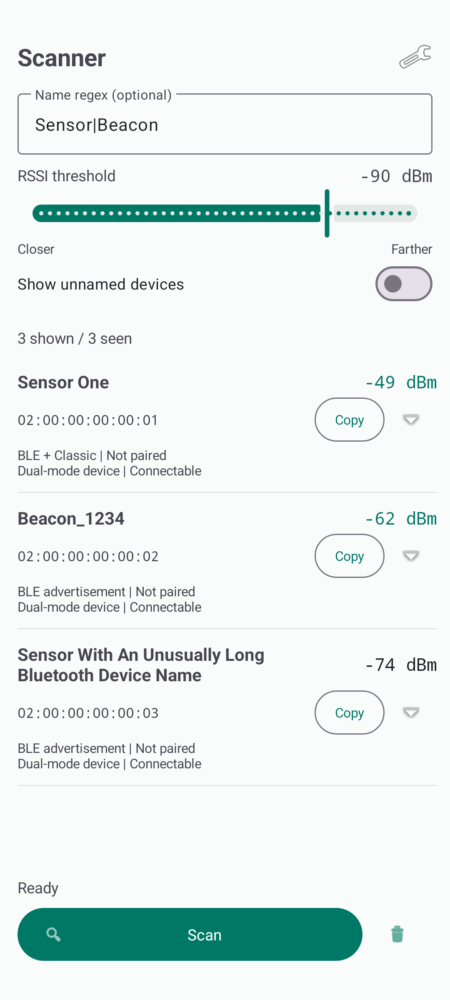

# Scanner

A small, vendor-independent Android app for discovering nearby Bluetooth devices.
Filter by signal strength, optionally narrow results with a name regex, and inspect
the information reported by Android. No account, backend, or device-specific SDK is required.

**Android 8.0+ | Kotlin | BLE and Bluetooth Classic | Version 1.0.2**



*Preview uses synthetic test data, not a live discovery capture.*

## Features

- One Scan button combines BLE advertisements and Classic discovery in one list.
- Reversed range slider from **20 to 110**, defaulting to **75**: lower values
  require stronger signals. The actual dBm threshold is always displayed.
- Optional, case-insensitive name regex with immediate validation.
- Unnamed devices hidden by default, with a switch to include them.
- Live results sorted from strongest to weakest signal and deduplicated by address.
- Device name, observed MAC address, latest RSSI, pairing state, reported device type,
  and BLE connectability when available.
- Expandable service UUIDs, manufacturer data, advertised transmit power, observation
  count, and last-seen age.
- Copy a device's address to the clipboard.
- Persistent filter preferences, light/dark themes, and portrait/landscape layouts.

The app only discovers devices. It does not connect, pair, read GATT characteristics,
play audio, or install firmware.

## Getting Started

1. Install a built APK on an Android device with Bluetooth hardware.
2. Open **Scanner** and adjust the RSSI slider: lower/left is closer, higher/right is farther.
3. Leave **Name regex** empty to filter named devices by RSSI alone, or enter a pattern.
   Turn on **Show unnamed devices** to include advertisements without a known name.
4. Tap **Scan** and grant the requested permissions. Enable Bluetooth if prompted.
5. Expand a result for additional details, or tap **Copy** to copy its address.

**Stop** retains the results for inspection. Starting a new scan clears the previous
scan. The trash button clears results without stopping an active scan.
Scanning stops when the app leaves the foreground.

### Filtering

A device is shown when its latest RSSI is **greater than or equal to** the selected
threshold and its name matches the optional regex. The slider uses the positive
magnitude of that negative threshold:

| Slider value | RSSI threshold | Signal requirement |
| --- | --- | --- |
| 20 | -20 dBm | Strongest / closest end |
| 50 | -50 dBm | Strong signals |
| 75 (default) | -75 dBm | Moderate range |
| 110 | -110 dBm | Weak signals included / farthest end |

For example, **-60 dBm** passes a **-75 dBm** threshold, while **-90 dBm** does not.
RSSI is signal strength, not a reliable physical distance measurement. Lowering the
slider narrows results to stronger signals. Saved dBm preferences from older builds
retain their meaning after this slider change.

Patterns search within the name by default. Use `^` and `$` for a full-name match.

| Name regex | Matches |
| --- | --- |
| *(empty)* | Any known name; also unnamed devices if **Show unnamed devices** is on |
| `sensor` | Any name containing "sensor", ignoring case |
| `Sensor\|Beacon` | Names containing either "Sensor" or "Beacon" |
| `^Sensor One$` | The exact name "Sensor One", ignoring case |
| `^Beacon_[0-9A-F]{4}$` | Names such as "Beacon_1234" or "Beacon_ABCD" |

Invalid patterns display an error and show no matches. They never silently disable
the name filter. Whitespace-only input is treated as empty. Unnamed devices are
hidden unless explicitly enabled; when enabled, their names are matched against
an empty string. Android's cached name is used if the advertised name is missing
or blank. A device with a previously observed name retains that name during the scan.

Regex matching uses [RE2/J](https://github.com/google/re2j), with a 256-character
pattern limit. Common groups, alternatives, character classes, anchors and repetitions
are supported; lookarounds and backreferences are not.

## Understanding Results

| Field | Meaning |
| --- | --- |
| Name | Advertised or cached device name; "Unnamed device" if unavailable |
| MAC address | The address exposed by Android for this observation |
| RSSI | Latest received signal strength in dBm |
| Scan source | BLE advertisement, Classic discovery, or both for the same address |
| Device type | Android's reported LE, Classic, dual-mode, or unknown type |
| Pairing state | Android's current bond state; not proof of an active connection |
| Connectable | Whether the BLE advertisement reports a connectable device |
| Service UUIDs | Advertised BLE UUIDs, or cached Classic UUIDs |
| Manufacturer data | Reported manufacturer IDs and up to 24 payload bytes per entry |
| TX power | Advertised transmit power, if present |

BLE advertisements do not expose every GATT service. Classic UUIDs are cached values,
not the result of a fresh SDP query. Audio profiles such as HFP and A2DP are not inferred
from a device's name or type. A dual-mode device can advertise over BLE while also
supporting Classic Bluetooth; these are different facts.

Addresses can be randomized and should not be treated as permanent hardware IDs.
Observations from BLE and Classic share one list. When both report the same address,
one row retains both sources and the available details. Different observed addresses
are not merged just because their names match.

Results refresh once per second. While scanning, devices not seen for 20 seconds are
hidden; stopped results remain inspectable. At most 500 observations are retained,
with one entry per address.

## Permissions and Privacy

| Android version | Requirements |
| --- | --- |
| Android 12+ | Nearby Devices permissions: Bluetooth Scan and Bluetooth Connect |
| Android 8-11 | Location permission and system Location services enabled |

Bluetooth Connect permission is used to read device names and bond state; the app
does not initiate connections. The Android 12+ scan permission uses `neverForLocation`,
which can cause Android to omit some location-oriented BLE beacons.

The app has **no Internet permission**, analytics, advertising SDK, or backend.
It does not request location coordinates. Scan results stay in memory and are not
saved or uploaded. Filter preferences are saved locally; device addresses enter
the system clipboard only when **Copy** is tapped.

## Build

### Requirements

- JDK 17.
- Android SDK Platform 35 and its build tools.
- Android Studio, or an Android SDK configured through `ANDROID_HOME` or an
  untracked `local.properties` file.

The project includes a Gradle 8.11.1 wrapper. The first build downloads its dependencies.

### Android Studio

Open this project directory, select JDK 17 as the Gradle JDK, sync, and run the
`app` configuration on a physical device or emulator.

### Command Line

From the project root, with Java and the Android SDK configured:

```sh
bash ./gradlew :app:assembleDebug
```

On Windows, use `gradlew.bat` instead of `bash ./gradlew`.

Output: `app/build/outputs/apk/debug/app-debug.apk`.

```sh
adb install -r app/build/outputs/apk/debug/app-debug.apk
```

The generic application ID and namespace are **`com.example.scanner`**. Choose an
identifier you control before distributing your own published application. Debug
APKs are development builds; use your own signing configuration for a production release.
Do not commit signing keys or credentials.

## Tests

```sh
bash ./gradlew :app:testDebugUnitTest :app:lintDebug
```

The unit tests cover regex validation and safety, combined filtering, RSSI boundaries,
unnamed devices, deduplication, result ordering, expiry, and bounded storage.

For the UI suite, connect a device or start an emulator, then run:

```sh
bash ./gradlew :app:connectedDebugAndroidTest
```

UI tests inject clearly synthetic device observations and cover filtering, device
details, unified sources, slider direction, and preference persistence. They do not prove radio discovery
works on a physical device. The UI tests reset this app's filter preferences; run them
on a test device or emulator.

## Troubleshooting

- **No results:** Check Bluetooth, permissions, the RSSI threshold, and the name pattern.
  Try an empty pattern and a lower threshold, such as -100 dBm.
- **Classic device missing:** Put the device in discoverable mode. A paired device is
  not necessarily discoverable.
- **Classic discovery cycles:** Android finishes each cycle automatically. While
  scanning, the app starts another cycle after a short pause; Stop cancels its own
  discovery and any scheduled restart. Existing discovery started by another app
  is observed without being cancelled. If one scan type fails, the other can continue
  and the status reports the limitation.
- **Scan rate limit:** Avoid rapid BLE scan restarts. Wait at least 30 seconds before
  retrying after a rate-limit error.
- **Older Android device:** Enable system Location services as well as granting the
  location permission.
- **Missing names or UUIDs:** Some devices do not advertise them. Fields reflect
  what Android reports, not a complete inventory of device capabilities.

## Project Structure

```text
app/src/main/java/com/example/scanner/
  BluetoothScanner.kt   Bluetooth scanning, permissions, and lifecycle cleanup
  ScanResults.kt        Result storage, RSSI filtering, and name regex matching
  DeviceAdapter.kt      Device rows and expandable details
  MainActivity.kt       Screen, preferences, and user actions
app/src/test/           JVM unit tests
app/src/androidTest/    Android UI tests
```

Runtime dependencies are AndroidX, Material Components, and RE2/J. There are no
proprietary device-vendor libraries. Build outputs, local SDK configuration, APKs,
and signing credentials are excluded by `.gitignore`.

## License

This project's own source is licensed under the [MIT License](LICENSE).
Third-party dependencies and build tooling retain their respective licenses and
notices; see [Third-Party Notices](THIRD_PARTY_NOTICES.md).
